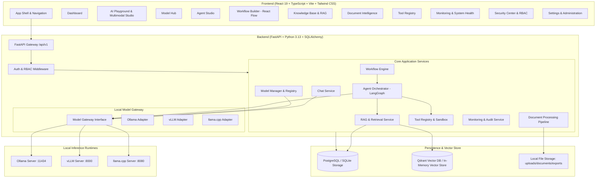

# Architecture Specification: Sovereign AI Workbench (SAW)

## 1. System Overview
Sovereign AI Workbench (SAW) is an on-premise, enterprise-grade Agentic AI platform enabling private, local-first execution of open-weight multimodal Large Language Models (LLMs), autonomous agents, multi-agent workflows, and document intelligence pipelines.

## 2. Architectural Principles
1. **Local-First & Air-Gapped Ready**: Operates without external cloud LLM dependencies. All prompts, documents, embeddings, and tool executions reside within the local network.
2. **Provider-Agnostic Model Gateway**: Standardized adapter pattern supporting Ollama, vLLM, and llama.cpp runtimes with real-time capability detection (vision, tool calling, context limits).
3. **Defense-in-Depth Agent Sandbox**: Bounded execution steps, timeouts, strict schema validation for tools, human-in-the-loop approvals for sensitive operations, and isolated execution.
4. **Observable & Traceable**: Structured JSON audit logging, correlation IDs across requests, and live system monitoring (CPU/RAM/Disk/VRAM).
5. **Role-Based Access Control (RBAC)**: Fine-grained permissions (Super Admin, Admin, Developer, Analyst, Viewer) enforced at the API and database levels.

## 3. High-Level Architecture Diagram

## 4. Component Details

### 4.1 Frontend Architecture
- **Framework**: Vite + React 18/19 with TypeScript.
- **Styling**: Tailwind CSS with enterprise dark-mode theme (`#0B0F19` background, `#111827` sidebar, `#151D2E` cards, Indigo/Cyan accents).
- **Icons**: `lucide-react`.
- **Visual Node Editor**: `@xyflow/react` (React Flow) for visual workflow orchestration.
- **Charts**: `recharts` for resource monitoring and inference latency.
- **Streaming**: Server-Sent Events (SSE) and fetch streaming readers for real-time token rendering and execution tracking.

### 4.2 Backend Architecture
- **API Framework**: FastAPI with asynchronous handlers and Pydantic v2 schemas.
- **Database ORM**: SQLAlchemy 2.0 with async engine and Alembic migrations. Works seamlessly with PostgreSQL and SQLite.
- **Vector Retrieval**: Qdrant client with automatic fallback to high-performance local cosine vector index for air-gapped lightweight installations.
- **Embeddings**: SentenceTransformers / ONNX local embeddings or high-speed deterministic semantic embeddings.
- **Document Extractors**: PyMuPDF (`fitz`), `python-docx`, `pandas`, `openpyxl`, and `pypdf`.
- **Agent Orchestrator**: LangGraph-inspired stateful execution graph with checkpointing, loop-bounds, and human-in-the-loop pause/resume hooks.
- **Sandboxed Execution**: Isolated Python environment with restricted built-ins, timeout protection, and memory safety checks.

### 4.3 Security & Sovereignty
- Zero external phone-home network calls.
- Configurable session expiration, JWT/Session authentication with PBKDF2/Argon2 password hashing.
- File validation by magic bytes, MIME types, and file size limits.
- Auditing of every model inference request, tool call, document upload, and user action.
