# Implementation Plan: Sovereign AI Workbench

## Overview & Execution Strategy
The project follows a phased delivery approach matching the PRD specifications. Each phase is implemented end-to-end with unit/integration testing and verification.

```mermaid
flowchart LR
    P1[Phase 1: Foundation & UI] --> P2[Phase 2: DB & Auth]
    P2 --> P3[Phase 3: Model Gateway]
    P3 --> P4[Phase 4: Playground & Multimodal]
    P4 --> P5[Phase 5: RAG & Doc Intel]
    P5 --> P6[Phase 6: Agent Studio]
    P6 --> P7[Phase 7: Workflow Builder]
    P7 --> P8[Phase 8: Monitoring & Security]
    P8 --> P9[Phase 9: Verification & Docs]
```

## Phase Breakdown

### Phase 1: Foundation and UI Scaffolding
- Initialize directory structure (`backend/`, `frontend/`, `infrastructure/`, `storage/`).
- Initialize React + TypeScript + Vite + Tailwind CSS frontend with dark theme.
- Create core layout shell, responsive sidebar with 11 navigation routes, header with health status & user profile.
- Setup FastAPI backend with CORS, exception handlers, health endpoints, and static mount.

### Phase 2: Database, Models & Authentication
- Setup SQLAlchemy database engine with asynchronous session management.
- Define relational schema models: `User`, `Session`, `ModelRecord`, `Conversation`, `Message`, `Attachment`, `Agent`, `Tool`, `AgentTool`, `Execution`, `ExecutionStep`, `Workflow`, `WorkflowRun`, `KnowledgeBase`, `Document`, `AuditLog`, `SystemMetric`.
- Implement JWT/Session authentication with password hashing, seed Super Admin (`admin@sovereign.local` / `Admin@123456`).
- Implement RBAC authorization middleware and permission dependency decorators.

### Phase 3: Model Gateway & Model Hub
- Implement `ModelProvider` abstract base class with standardized methods:
  - `list_models()`, `get_model_info()`, `health_check()`, `chat()`, `stream_chat()`, `unload()`.
- Implement concrete adapters:
  - `OllamaAdapter` (calls `http://localhost:11434` / Ollama REST API with streaming support and capability discovery).
  - `VLLMAdapter` (OpenAI-compatible vLLM endpoint).
  - `LlamaCppAdapter` (llama.cpp server endpoint).
  - `MockLocalAdapter` (built-in local offline fallback for testing when no runtime is running).
- Build Model Hub UI: model listing, registration dialog, endpoint health status indicator, capability tags (vision, tools, context length).

### Phase 4: AI Playground & Multimodal Studio
- Build Chat UI with conversation drawer, markdown parsing, code syntax highlighting, copy-to-clipboard, streaming response, stop generation, and parameter tuning (temperature, top_p, max_tokens, stop sequences).
- Multimodal upload pipeline:
  - Images: PNG, JPG, WEBP preview & base64 conversion for vision models.
  - Documents: PDF, DOCX, TXT, CSV parsing & preview.
  - Audio/Video: Frame extraction & transcription hooks.

### Phase 5: Knowledge Base, Document Intelligence & RAG
- Knowledge Base management (CRUD, chunk size, overlap, embedding configuration).
- Document ingestion pipeline: PyMuPDF / python-docx / pandas parsing, chunking with overlap and metadata retention.
- Vector store integration (Qdrant client + built-in cosine similarity vector store for standalone operation).
- Grounded RAG query endpoint returning context-grounded answers with exact citations and confidence scores.
- Document Intelligence workspace: summarization, entity extraction, table viewer, and document comparison diffing.

### Phase 6: Agent Studio & Safe Execution Engine
- Agent configuration: System prompts, assigned model, enabled tools, knowledge base connections, max steps, approval policy.
- Built-in starter agent templates: Research Agent, Document Intelligence Agent, Data Analyst Agent, Coding Assistant, Workflow Automation Agent.
- LangGraph-style stateful execution runtime:
  - Step iteration, tool invocation, human approval pause / resume / reject, loop guards, error recovery.
- Execution history viewer with step-by-step trace and inputs/outputs.

### Phase 7: Multi-Agent Workflow Builder
- Visual node canvas using React Flow (`@xyflow/react`).
- Node types: Start, User Input, LLM, Agent, RAG Search, Tool, Condition, Loop, Human Approval, Data Transform, Output.
- Graph validator (cycle detection, required connections, type matching).
- Async execution engine with real-time node state progression (pending, running, completed, paused_for_approval, failed).

### Phase 8: Tool Registry, Monitoring & Security Center
- Built-in tools: Calculator, File Reader, Knowledge Search, Isolated Python Executor, CSV/Tabular Analyzer, SQL Query Tool, Allowlisted HTTP Client.
- System Monitoring: Real-time CPU, RAM, Disk, and GPU stats via `psutil`. Request latency and token throughput charts.
- Security Center: User management, RBAC editor, searchable audit logs, air-gap / outbound network sovereignty status.

### Phase 9: Testing, Docker & Documentation
- Comprehensive test suite: API tests, model gateway tests, RAG tests, agent execution tests.
- Docker Compose configuration (`frontend`, `backend`, `postgres`, `qdrant`, `redis`, `ollama`).
- Complete documentation: `README.md`, `ARCHITECTURE.md`, `API_SPECIFICATION.md`, `INSTALLATION.md`, `DEPLOYMENT.md`, `OFFLINE_DEPLOYMENT.md`, `TESTING.md`.
